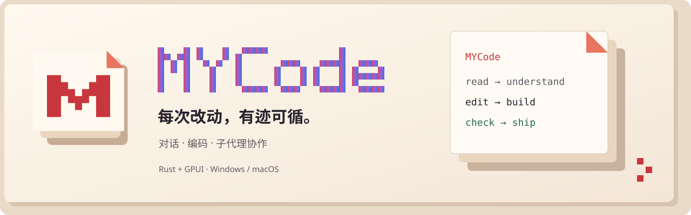

<div align="center">



<p>
  <a href="https://github.com/MCapricorns/mycode/releases/latest"></a>
  <a href="https://github.com/MCapricorns/mycode/actions"></a>
  
  <a href="LICENSE"></a>
</p>

**打开项目，用自然语言读代码、修改文件、运行命令。**

[下载](https://github.com/MCapricorns/mycode/releases/latest) · [快速开始](#快速开始) · [开发](#参与开发) · [Wiki](https://mcapricorns.github.io/mycode/wiki/index.html) · [更新日志](CHANGELOG.md)

</div>

MYCode 是使用 Rust 和 GPUI 的原生编码代理。模型通过本机 [magpie](https://usemagpie.ai) 网关连接；项目操作、会话记录、工具执行和界面状态由 MYCode 管理。发送给模型的消息、附件和工具结果经过网关转发到你配置的上游服务。

## 安装

从 [Releases](https://github.com/MCapricorns/mycode/releases/latest) 下载对应安装包。每个包附带 SHA-256 校验文件。

| 平台 | 手动安装包 |
| --- | --- |
| Windows x64 | `mycode-desktop-v*-x86_64-pc-windows-msvc.zip` |
| Windows ARM64 | `mycode-desktop-v*-aarch64-pc-windows-msvc.zip` |
| macOS Apple Silicon | `mycode-desktop-v*-aarch64-apple-darwin.dmg` |

Windows 解压后运行 `mycode-desktop.exe`，应用会安装到 `~/.mycode/bin/mycode-desktop.exe` 并创建桌面快捷方式。下载副本会在安装完成后清理。macOS 打开 dmg，将 MYCode 拖进「应用程序」；首次运行可右键选择「打开」。应用使用 ad-hoc 签名，必要时执行：

```sh
xattr -d com.apple.quarantine /Applications/MYCode.app
```

标题栏会提示可用更新，确认后重启安装。macOS Release 中的 zip 供自动更新使用。当前支持 Windows x64、Windows ARM64、macOS Apple Silicon，不提供 Linux、Intel macOS 或 Windows x86 安装包。

## 快速开始

1. 安装并启动 magpie，在其中配置模型服务与账号。
2. 安装 MYCode 插件：

   ```sh
   magpie plugin add github:MCapricorns/magpie-mycode
   ```

3. 在 magpie 的 Agents 页为 **MCode** 选择模型。插件会写入 MYCode 的网关绑定。
4. 打开 MYCode，选择或拖入项目目录，然后输入任务。

MYCode 的「设置 → Magpie」显示网关连接和模型目录。修改 magpie 绑定后，点击「刷新模型」即可同步。没有模型时，先确认 magpie 正在运行、插件已安装、MCode 已完成模型选择。

## 日常使用

左侧分别显示项目和当前项目的对话。选择项目会打开最近的对话，没有历史则创建新对话。「新对话」或 `/new` 保留当前项目；移除项目入口不会删除文件或历史。未绑定项目的旧会话位于「未分配」。

使用 `@` 搜索文件，或拖入文本文件、图片。每条消息最多 4 张图片与 8 个文本文件；单张图片原始数据最多 3.75 MB，全部图片 base64 合计最多 6 MiB；文本单文件最多 256 KiB，合计最多 512 KiB。超长文本会标记截断。

模型和思考强度按会话保存。模型标签显示网关提供的来源；不同来源的同名模型分别保留。思考菜单只提供模型公布的档位。

| 操作 | Windows | macOS |
| --- | --- | --- |
| 命令面板 | Ctrl-K | Cmd-K |
| 换行 | Shift-Enter | Shift-Enter |
| 运行中补充引导 | Ctrl-G | Cmd-G |
| 打断并发送 | Ctrl-Enter | Cmd-Enter |
| 粘贴图片 | Ctrl-V | Cmd-V |

`/compact` 压缩当前上下文，`/settings` 打开设置。运行中按 Enter 可选择引导或打断；未读引导可以撤回。停止会取消当前回合、工具和子代理，保留已收到的内容及已经发生的文件修改。

历史消息的「撤回并编辑」会回退对话并将原文放回输入框。**它只改变对话历史，不回滚工作区文件。** 修改后可在改动面板查看 Git diff。

## 规则、技能与工具

magpie Library 写入全局规则、技能和 MCP 配置。项目规则依次读取 `AGENTS.md`、`MYCODE.md`、`.mycode/agents.md`、`.agents/AGENTS.md`，项目规则覆盖全局默认，同一目录后读的规则覆盖前面的冲突项。用户明确指令优先。

主代理直接调用平台 shell、`run_code` 和 `wait_code`。其余已注册工具通过 CodeMode 的同步 `call(name, args)` 调用。CodeMode 使用嵌入式 QuickJS，不提供 Node.js、浏览器 API、async/await 或 Promise 任务执行。它每个 cell 允许最多 256 次工具调用；长任务返回 cell ID 后，应继续收集同一次执行。

MYCode 没有内置网页搜索。配置 MCP 服务后，通过 `search_tool` / `tool_search` 发现 schema，再用 `use_tool` 调用。工具以当前用户权限运行；worktree 和脚本资源限制不构成操作系统沙箱。

## 子代理与流程

| 角色 | 职责 | 边界 |
| --- | --- | --- |
| scout | 检索代码、文档和事实，给出证据 | 只读，无 shell |
| artisan | 实施范围明确的修改并验证 | 默认使用 Git worktree |
| sentinel | 独立审查实现、diff 和验收条件 | 只读，无 shell |
| skeptic | 对明确的假设或结论寻找反例 | 只读，无 shell |

角色可在全局 `~/.mycode/agents/` 或项目 `.mycode/agents/` 覆盖、扩展，并在设置中启停。内置只读角色不会因覆盖提示词而获得写入能力。普通 `agent` 调用顺序执行；固定 workflow 可以调度独立节点。没有全局 subagent 并发数量上限，但重叠的活跃写入 scope 会被拒绝。

`agent_workflow` 提供 research、code-review 和 migration。流程需要独立 sentinel 验收；migration 的写入节点完成后等待主代理整合 worktree，再显式 resume。失败后可使用 revise 提交反馈并重跑受影响节点。子代理不会自动提交、合并或推送。

结果、错误、产物路径和保留的 worktree 可跨回合查询。即使关闭全部角色，已有结果仍可通过 agent_status 检查，已有运行仍可通过 agent_stop 取消。agent_message 的完成后续接使用摘要启动新运行，不恢复原始模型会话；取消的任务不能续接。

## 本地数据

默认目录是 `~/.mycode`，可在启动前用绝对路径环境变量 `MYCODE_HOME` 改写。已有数据需自行迁移，并保持 magpie 与 MYCode 指向同一目录。

| 路径 | 内容 |
| --- | --- |
| settings.json | 网关绑定、界面、网络、角色和技能设置 |
| ui.json | 项目入口、会话目录关联、模型选择、窗口状态 |
| sessions.db、sessions/ | 会话索引、事件账本、附件和压缩检查点 |
| AGENTS.md、skills/、mcp.json | 全局规则、技能与 MCP 服务 |
| secrets.json | MYCode 保存的 MCP 密钥 |
| agents/、agent-worktrees/、agent-results/ | 自定义角色、保留工作树和完整结果 |
| mcp-results/、scratch/ | 大型 MCP 结果与临时工作目录 |
| bin/、update/ | Windows 安装和更新暂存 |

配置采用严格 JSON。损坏的配置会生成备份并抢救可用字段；临时 I/O 错误不会重置健康文档。分享配置和诊断文件前请删除其中凭据。

## 参与开发

工作区仅有两个 package，内部类型直接从所属模块导入：

| package | 职责 |
| --- | --- |
| mycode | core、config、providers、tools、agent、app、frontend 模块；不依赖 GPUI |
| mycode-desktop | 原生窗口、渲染、剪贴板和桌面交互；依赖 mycode |

需要 Rust stable 和原生构建工具。Windows 使用 MSVC 与 C++ Build Tools；macOS 使用 Xcode Command Line Tools。QuickJS 需要 C 编译器。

```sh
git clone https://github.com/MCapricorns/mycode.git
cd mycode
cargo run -p mycode-desktop --locked
cargo build --release -p mycode-desktop --locked
```

Debug 构建跳过 Windows 自安装；直接运行 release binary 时，设置 `MYCODE_NO_INSTALL=1` 可留在构建目录运行。

提交前执行：

```sh
cargo fmt --all -- --check
cargo test --workspace --locked
cargo test -p mycode-desktop --features test-support --locked
cargo clippy --workspace --all-targets --locked -- -D warnings
python scripts/build_wiki.py
python scripts/build_wiki.py --check
python -B -m unittest discover -s wiki/tests -v
```

CI 在 Windows x64、Windows ARM64、macOS Apple Silicon 原生运行测试，Windows x64 运行 Clippy。带 `[release]` 的 main 推送在全部检查与构建成功后发版。版本号由发布脚本统一更新两个 package，发布失败不会提前推进 main。

模块职责、取消与数据约定见 [运行时架构](wiki/architecture/runtime.md)；脚本协议见 [CodeMode](wiki/architecture/code-mode-engine.md)；文档生成方式见 [Wiki 维护说明](wiki/README.md)。

## Contributors

感谢参与开发的真人贡献者：

- [MCapricorns](https://github.com/MCapricorns)
- [YangChengxxyy](https://github.com/YangChengxxyy)

作者别名由 [.mailmap](.mailmap) 归一化。此名单仅列人类贡献者，自动化账号不列入。

## 社区与许可

问题与建议：[GitHub Issues](https://github.com/MCapricorns/mycode/issues)。作者动态：[@M_Capricorns](https://x.com/M_Capricorns)。

采用 [Apache-2.0](LICENSE) 许可。
