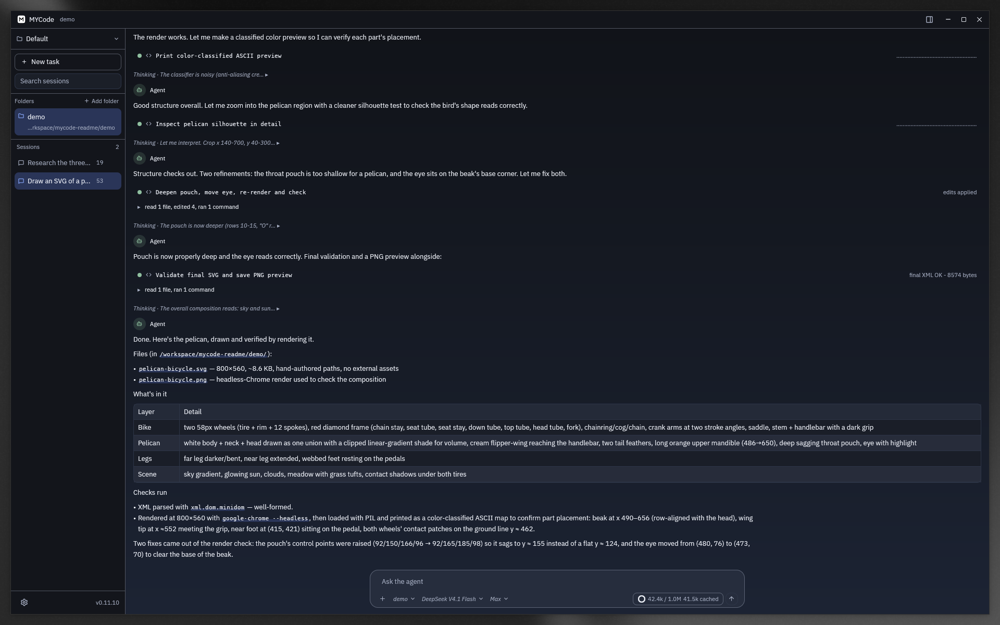

# mycode

本地优先的桌面编码代理。对话和工具都在你的电脑上；你自己带 API 密钥。



一次画完的鹈鹕 SVG。工具调用收成一行，回复里是图层对照表。输入框居中，旁边是缓存环。

## 功能

- 一个工作区挂多个文件夹。会话属于工作区。
- 模型直接调用原生工具：`read`、`write`、`edit`、每平台一个 shell、`grep`、`find`。
- 只读的 `scout` 和有界的 `artisan`，也可以在 `agents/` 里加角色。
- 内置 [models.dev](https://models.dev) 目录。Copilot 和 Codex 用设备码登录，其它服务商（包括 xAI）粘贴 API key。OpenDesign 网关有单独的入口，按密钥实时列出可用模型。
- 中英界面，深色和浅色主题。

## 安装

[Releases](https://github.com/MCapricorns/mycode/releases) 提供三个平台的压缩包：Windows x64、Windows ARM64、macOS Apple Silicon（zip 和 dmg），旁边有 `.sha256`。没有 Intel macOS 包，也没有 Linux 包。dmg 里的 app 是 ad-hoc 签名，首次打开用右键「打开」，或 `xattr -d com.apple.quarantine /Applications/MYCode.app`。说明用该版本的更新日志，再附上自上一个标签以来的 pull request。`github-actions[bot]` 写回版本时不会再开一次发布。

从源码构建需要 Rust stable。Windows 用 MSVC。

```text
cargo build --release -p mycode-desktop
```

## 快速开始

打开一个文件夹，在输入框里说话。`/` 列出 `/new`、`/compact`、`/settings`、技能和 MCP。输入框旁切换模型和思考强度。`Cmd-K`（macOS）或 `Ctrl-K`（Windows、Linux）打开命令面板，可搜索会话、模型、斜杠命令和设置页。`↑` `↓` 移动，Enter 打开，Esc 关闭。

## 配置和工具

未设置 `MYCODE_HOME` 时，数据在 `~/.mycode`：`settings.json`（不含密钥）、`secrets.json`、`ui.json`、会话和 `agents/`。

模型直接发出 `read`、`write`、`edit`、`grep`、`find` 和当前平台的一个 shell 工具调用；MCP 工具按名字直接调用。`script` 模式跑会话解析出的那个解释器，`program` 模式按显式参数启动一个可执行文件。环境变量白名单不是沙箱，进程以当前用户权限运行。细节在 [docs/tools.md](docs/tools.md)。

## 文档

模块怎么分、一条消息怎么走完，见 [docs/README.md](docs/README.md)。更多界面截图在 [docs/desktop.md](docs/desktop.md)。

## 许可

[Apache-2.0](LICENSE)

---

## English

mycode is a local-first desktop coding agent. The conversation and tools stay on your machine. You bring the API keys.


A finished pelican SVG. Tool calls collapse to one line, and the reply includes a comparison table. The composer stays centered, with a cache ring.

### Features

- One workspace mounts several folders. Sessions belong to the workspace.
- The model calls native tools directly: `read`, `write`, `edit`, one shell per platform, `grep`, and `find`.
- Read-only `scout` and bounded `artisan`, or custom roles under `agents/`.
- Built-in [models.dev](https://models.dev) catalog. Copilot and Codex sign in with a device code; other providers, xAI included, take a pasted API key. The OpenDesign gateway has its own entry that lists the models your key can use.
- English and Chinese UI, dark and light themes.

### Install

[Releases](https://github.com/MCapricorns/mycode/releases) publish one archive for each of the three platforms: Windows x64, Windows ARM64, and macOS Apple Silicon (zip and dmg), each with a `.sha256`. There is no Intel macOS build and no Linux build. The app inside the dmg is ad-hoc signed; right-click → Open once, or `xattr -d com.apple.quarantine /Applications/MYCode.app`. The body starts with that version's changelog, then the pull requests since the previous tag. A version commit by `github-actions[bot]` does not start another release.

Build from source with Rust stable. MSVC on Windows.

```text
cargo build --release -p mycode-desktop
```

### Quick start

Open a folder and type. `/` lists `/new`, `/compact`, `/settings`, skills, and MCP. Switch model and thinking effort beside the composer. `Cmd-K` on macOS, or `Ctrl-K` on Windows and Linux, opens the command palette: search sessions, models, slash commands, and settings pages. `↑` `↓` move, Enter opens, Esc closes.

### Config and tools

`MYCODE_HOME` defaults to `~/.mycode` (`settings.json` without secrets, `secrets.json`, `ui.json`, sessions, and `agents/`).

The model emits `read`, `write`, `edit`, `grep`, `find`, and one shell tool for the current platform directly; MCP tools are called by name. `script` mode runs the interpreter resolved for the session and `program` mode launches one executable with an explicit argument vector. The environment allowlist is not a sandbox; processes run with current-user authority. Details: [docs/tools.md](docs/tools.md).

### Docs

How the crates split and how one message moves: [docs/README.md](docs/README.md). More screenshots: [docs/desktop.md](docs/desktop.md).

### License

[Apache-2.0](LICENSE)
