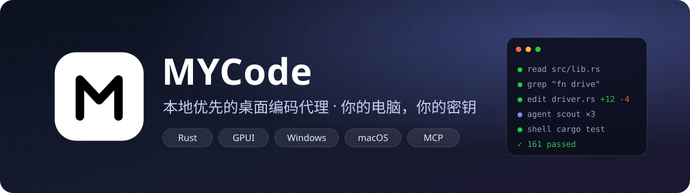
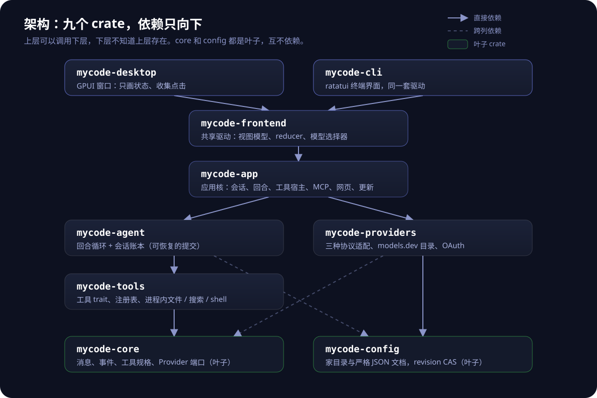
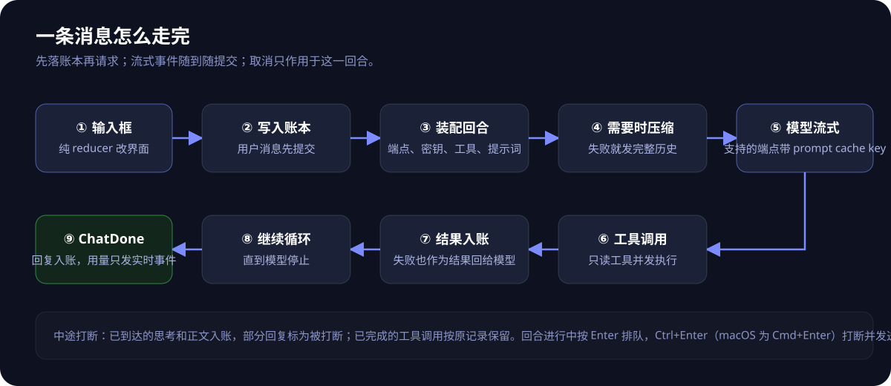

<div align="center">



<p>
  <a href="https://github.com/MCapricorns/mycode/releases/latest"></a>
  <a href="https://github.com/MCapricorns/mycode/releases"></a>
  <a href="https://github.com/MCapricorns/mycode/actions"></a>
  
  
  <a href="LICENSE"></a>
  <a href="https://x.com/M_Capricorns"></a>
</p>

**对话、工具和会话都留在你的电脑上。你带上自己的 API 密钥，剩下的交给它。**

[下载](https://github.com/MCapricorns/mycode/releases/latest) · [快速开始](#快速开始) · [功能](#功能) · [架构](#架构) · [文档](docs/README.md) · [更新日志](CHANGELOG.md)

</div>

---

## 为什么是 MYCode

- **本地优先。** 界面不读密钥、不写文件、不发网络请求；模型请求只发往你配置的服务商。
- **原生工具。** 模型直接调用 `read`、`write`、`edit`、`grep`、`find` 和当前平台的一个 shell。搜索在进程内完成，不依赖外部 `rg` / `fd`。
- **省钱。** system prompt 在文件不变时字节稳定，请求带会话级 `prompt_cache_key`，前缀缓存命中率高；输入框旁的缓存环实时显示。
- **不丢数据。** 会话账本用 revision 比较交换和原子替换提交；中途打断时已到达的内容照样入账。

## 功能

| | |
| --- | --- |
| **工作区** | 一个工作区挂多个文件夹，会话属于工作区。改动面板跟随文件系统事件读 `git status`。 |
| **模型** | [models.dev](https://models.dev) 云端目录（200+ 服务商，缓存一天一刷）。Copilot、Codex 用设备码登录；其它服务商（含 xAI、OpenDesign 网关）粘贴 API key。 |
| **思考强度** | 按模型给出可选档位：关、低、高、Max……每个会话单独记住。 |
| **子代理** | 只读的 `scout` 做代码搜索、网页调研、查 API 文档；`artisan` 在独立 worktree 里改代码。同时最多 8 个，不设超时；取消、停止或删除对话时一起结束。也可以在 `agents/` 里加自定义角色。 |
| **技能** | 读取 `.agents/skills` 下的 `SKILL.md`，`/` 一键插入；设置里每个技能可以单独开关。 |
| **MCP** | 支持 stdio 与 HTTP，多个服务器并发连接；只读工具可并发调用。 |
| **网页** | 内置搜索与抓取后端，结果有字节上限。 |
| **界面** | 中英双语、深浅主题、四档字号；`Ctrl-K` / `Cmd-K` 命令面板。 |
| **终端版** | `mycode-cli` 和桌面版共用同一套会话、设置与工具；`/settings` 选模型、填密钥、开关 MCP。 |
| **代理** | 跟随系统代理，或手动填写 `http` / `socks5` 地址；设置里「测试」一键确认能否连通 google.com。 |

## 安装

从 [Releases](https://github.com/MCapricorns/mycode/releases/latest) 下载，每个文件旁有 `.sha256`：

| 平台 | 桌面版 | 终端版 |
| --- | --- | --- |
| Windows x64 | `mycode-desktop-v*-x86_64-pc-windows-msvc.zip` | `mycode-cli-v*-x86_64-pc-windows-msvc.zip` |
| Windows ARM64 | `mycode-desktop-v*-aarch64-pc-windows-msvc.zip` | `mycode-cli-v*-aarch64-pc-windows-msvc.zip` |
| macOS Apple Silicon | `mycode-desktop-v*-aarch64-apple-darwin.dmg` | `mycode-cli-v*-aarch64-apple-darwin.zip` |

- **Windows 桌面版**：解压后双击 `mycode-desktop.exe`。它会把自己装到 `~/.mycode/bin/mycode-desktop.exe`，启动装好的那份，删掉刚才双击的旧 exe，并在桌面放 `MYCode` 快捷方式。以后从快捷方式打开即可。
- **macOS 桌面版**：打开 dmg，把 `MYCode.app` 拖进「应用程序」。应用是 ad-hoc 签名，首次打开请右键「打开」，或执行 `xattr -d com.apple.quarantine /Applications/MYCode.app`。
- **终端版 `mycode-cli`**：首次运行把自己复制进 `~/.mycode/bin`，并把该目录加进用户 `PATH`（Windows 写注册表，macOS 写 `~/.zprofile` 等 shell 配置）。随后会提示安装位置，按 Enter 继续；之后新开的终端里直接敲 `mycode-cli` 就能运行。

两个程序都内置自动更新，只取自己那一类的安装包：桌面版右上角提示可更新，下载并校验后确认即重启安装；终端版在 `/settings` 的「Update」一行检查和安装。Release 里 macOS 桌面版的 zip 只给自动更新用，手动安装请用 dmg。暂无 Intel macOS 和 Linux 包。`MYCODE_NO_INSTALL=1` 可以跳过自安装。

### 从源码构建

需要 Rust stable（Windows 用 MSVC 工具链）：

```sh
git clone https://github.com/MCapricorns/mycode.git
cd mycode
cargo build --release -p mycode-desktop -p mycode-cli
```

从源码跑发布版时，建议设 `MYCODE_NO_INSTALL=1`，免得它把自己装进 `~/.mycode/bin`。

## 快速开始

1. 打开设置 → 模型，登录 Copilot / Codex，或粘贴任意服务商的 API key。
2. 回到工作台，添加一个文件夹。
3. 在输入框里说出你要做的事。

| 操作 | 方式 |
| --- | --- |
| 斜杠命令 | 输入 `/`：`/new`、`/compact`、`/settings`、技能、MCP |
| 切换模型 / 思考强度 | 输入框旁的两个菜单 |
| 命令面板 | `Ctrl-K`（Windows）/ `Cmd-K`（macOS），搜索会话、模型、命令和设置页 |
| 回合中追加指令 | 直接发送，会作为 Steer 注入当前回合 |

## 架构

<p align="center">
  
</p>

<p align="center">
  
</p>

细节见 [docs/architecture.md](docs/architecture.md)。

## 配置与数据

未设置 `MYCODE_HOME` 时，数据在 `~/.mycode`：

```text
~/.mycode/
├─ settings.json   服务商、MCP、网页、外观、子代理、技能开关（不含密钥）
├─ secrets.json    API 密钥与 OAuth 令牌
├─ ui.json         工作区、文件夹、每个会话的模型与思考档位
├─ sessions.db     会话索引
├─ sessions/       会话账本（JSONL）
├─ agents/         自定义子代理角色
└─ bin/            自安装的 mycode-cli（Windows 上还有 mycode-desktop）
```

工具以当前用户权限运行，环境变量白名单不是沙箱。详见 [docs/tools.md](docs/tools.md) 和 [docs/config.md](docs/config.md)。

## 文档

| 文档 | 内容 |
| --- | --- |
| [docs/README.md](docs/README.md) | 总览与阅读顺序 |
| [docs/architecture.md](docs/architecture.md) | crate 分层、一条消息怎么走、家目录 |
| [docs/desktop.md](docs/desktop.md) | 界面与交互 |
| [docs/tools.md](docs/tools.md) | 内置工具与子代理 |
| [docs/providers.md](docs/providers.md) | 协议适配与模型目录 |
| [docs/config.md](docs/config.md) | 设置文档与上限 |

## 社区

- 关注 X（Twitter）：[@M_Capricorns](https://x.com/M_Capricorns)
- 问题与建议：[GitHub Issues](https://github.com/MCapricorns/mycode/issues)

## 许可

[Apache-2.0](LICENSE)

<div align="center">
<sub>用 Rust 和 GPUI 构建 · <a href="https://x.com/M_Capricorns">@M_Capricorns</a></sub>
</div>
