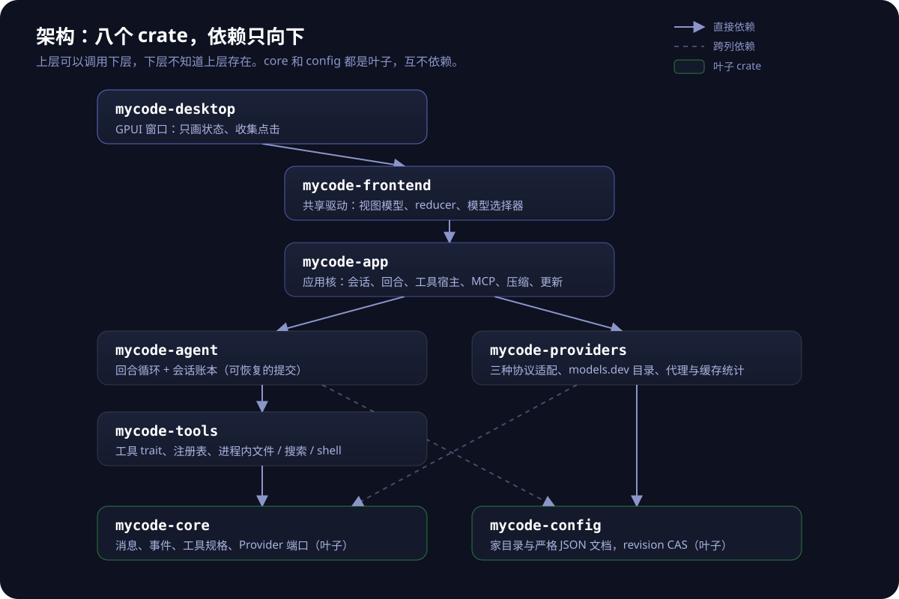
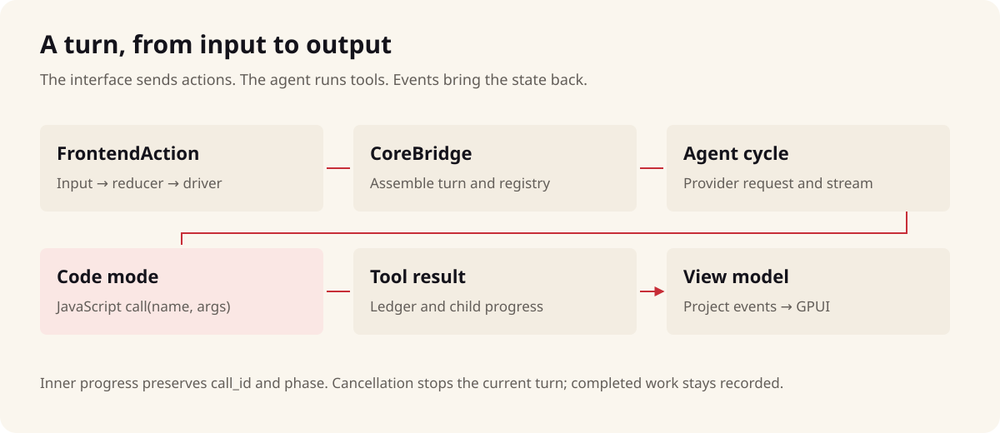

<div align="center">


<p>
  <a href="https://github.com/MCapricorns/mycode/releases/latest"></a>
  <a href="https://github.com/MCapricorns/mycode/releases"></a>
  <a href="https://github.com/MCapricorns/mycode/actions"></a>
  
  
  <a href="LICENSE"></a>
  <a href="https://x.com/M_Capricorns"></a>
</p>

**对话、工具调用和会话记录都留在本机。模型请求只发往本机 magpie 网关。**

[下载](https://github.com/MCapricorns/mycode/releases/latest) · [快速开始](#快速开始) · [功能](#功能) · [数据](#数据与配置) · [架构](#架构) · [知识图谱](https://mcapricorns.github.io/mycode/wiki/index.html) · [更新日志](CHANGELOG.md)

</div>

---

## 是什么

MYCode 是一个本地编码代理桌面应用。

支持 Windows x64、Windows ARM64 和 macOS Apple Silicon，暂无 Intel macOS 和 Linux 包。

## 功能

| | |
| --- | --- |
| **工作目录** | 最多同时挂 8 个目录，可以拖进来（从旧版合并的列表可能暂时更多，新增时保持现有数量）。会话绑定到一个目录；切换目录不会把当前会话改绑。改动面板跟随文件系统事件读 `git status`，不按固定间隔轮询。 |
| **模型** | 只通过本机 [magpie](https://usemagpie.ai) 网关请求模型。模型列表实时读取网关的 `GET /v1/models`；在 magpie 的 Agents 页给 MCode 选模型，密钥和地址由 magpie 的 agent 插件写进 `~/.mycode/settings.json`。 |
| **思考强度** | 只列模型实际公布的档位。每个会话单独记住自己的模型和强度，不影响别的会话。 |
| **附件** | 拖入文件或粘贴图片即附加到下一条消息：最多 4 张图、8 个文本文件。拖入文件夹则绑定为工作目录。 |
| **子代理** | `scout` 只读，适合宽范围代码搜索和查文档（可用 magpie 下发的只读 MCP 工具）；`artisan` 在独立的 git worktree 里改代码，结束时回传 diff，不自动合回、不提交。每个回合最多同时跑 8 个，没有超时；取消回合、单独停止或删除对话都会结束它们。也可以在 `agents/` 里加自定义角色。 |
| **技能** | 从 `.agents`、`.agents/skills` 和 magpie Library 的 `~/.mycode/skills` 发现 `SKILL.md`，`/` 菜单可插入；设置里每个技能可以单独关闭。 |
| **MCP** | 支持 stdio 和 Streamable HTTP，最多 64 台服务器。工具不超过 4 个、且每个 schema 不超过 2048 字节的小服务直接注册成普通工具，其余走 `search_tool` / `use_tool`。magpie Library 写入的 `~/.mycode/mcp.json` 会自动合并。 |
| **网页** | 没有内置搜索；联网检索由 magpie Library 下发的 MCP 服务提供（例如 anysearch）。 |
| **界面** | 中英双语、深色/浅色、四档字号，`Ctrl-K` / `Cmd-K` 打开命令面板。 |
| **代理** | 跟随系统代理，或手动填写 `http` / `socks5` 地址。设置页的「测试」会请求 `google.com/generate_204` 并显示线路、状态码和耗时。 |

## 安装

从 [Releases](https://github.com/MCapricorns/mycode/releases/latest) 下载。每个包旁边都有对应的 `.sha256`。

| 平台 | 安装包 |
| --- | --- |
| Windows x64 | `mycode-desktop-v*-x86_64-pc-windows-msvc.zip` |
| Windows ARM64 | `mycode-desktop-v*-aarch64-pc-windows-msvc.zip` |
| macOS Apple Silicon | `mycode-desktop-v*-aarch64-apple-darwin.dmg` |

- **Windows**：解压后双击 `mycode-desktop.exe`。它会把自己复制到 `~/.mycode/bin/mycode-desktop.exe`，启动装好的那一份，删掉刚双击的旧 exe，并在桌面创建 `MYCode` 快捷方式。以后从快捷方式打开。
- **macOS**：打开 dmg，把 `MYCode.app` 拖进「应用程序」。应用是 ad-hoc 签名，首次打开需要右键「打开」，或执行 `xattr -d com.apple.quarantine /Applications/MYCode.app`。

应用内置自动更新：标题栏提示新版本，确认后重启安装。Release 里的 macOS zip 是给自动更新用的，手动安装请用 dmg。

`MYCODE_NO_INSTALL=1` 可以跳过自安装，适合直接从 `target/` 运行。

### 从源码构建

需要 Rust stable（Windows 用 MSVC 工具链）：

```sh
git clone https://github.com/MCapricorns/mycode.git
cd mycode
cargo build --release -p mycode-desktop
```

从源码运行发布版时建议设置 `MYCODE_NO_INSTALL=1`，免得它把自己装进 `~/.mycode/bin`。

## 快速开始

1. 安装 [magpie](https://usemagpie.ai)，在本仓库运行 `magpie plugin add github:MCapricorns/magpie-mycode`（或在 magpie 的 Plugins 页填同样的 `github:` 地址）。
2. 在 magpie 的 Agents 页给 **MCode** 选一个模型。MCode 启动新会话时读取网关地址和密钥。
3. 打开一个目录。
4. 在输入框里描述你要做的事。

| 操作 | 方式 |
| --- | --- |
| 斜杠命令 | 输入 `/`：`/new`、`/compact`、`/settings`、已启用的技能和 MCP |
| 引用文件 | 输入 `@` 搜索当前目录里的文件 |
| 附加图片 | `Ctrl-V`（macOS `Cmd-V`）粘贴剪贴板图片；粘贴内容是单个图片路径时附加该文件 |
| 切换模型 / 思考强度 | 输入框旁的两个菜单 |
| 命令面板 | `Ctrl-K`（Windows）/ `Cmd-K`（macOS），搜索会话、模型、命令和设置页 |
| 回合进行中继续输入 | `Enter` 把消息排到本轮之后（最多 8 条）；`Ctrl-Enter` 停止当前回合并立即发送；`Ctrl-G` 引导：不停止回合，模型在下一步之前读到这条消息。macOS 上用 `Cmd` |
| 快捷键一览 | 「设置 → 快捷键」 |

## 数据与配置

未设置 `MYCODE_HOME` 时，数据在 `~/.mycode`：

```text
~/.mycode/
├─ settings.json        magpie 网关、MCP、外观、代理、子代理、技能开关（密钥在 magpie 里）
├─ AGENTS.md            magpie Library 写入的全局规则（也可手写）
├─ mcp.json             magpie Library 写入的 MCP 服务器
├─ skills/              magpie Library 写入的技能
├─ secrets.json         MCP 密钥
├─ ui.json              最近目录、会话归属、每个会话的模型与思考档位、窗口状态
├─ sessions.db          会话索引
├─ sessions/            会话账本（JSONL、payloads、compaction.json）
├─ agents/              自定义子代理角色
├─ agent-worktrees/     子代理的临时 worktree
├─ mcp-results/         被截断的 MCP 结果全文
├─ scratch/             没有绑定目录时的工具工作目录
├─ bin/                 自安装的 mycode-desktop
└─ update/              自动更新暂存
```

设置、密钥和界面状态是严格 JSON。写坏的文档会备份到旁边的 `*.broken-*`，能救的字段会保留，救不回来的回到默认值。会话账本用 `sessions.db` 作为提交权威，事件写在 JSONL 里；崩溃留下的半截写入会被截掉，索引和日志对不上则明确报损坏，不猜。

工具以当前用户权限运行。环境变量白名单只是过滤，不是沙箱。

## 架构

工作区分成八个 crate，依赖只向下：`mycode-desktop` 是界面，`mycode-frontend` 放共享的视图模型和 reducer，`mycode-app` 是应用核，下面是 `mycode-agent`、`mycode-providers`、`mycode-tools`，最底层是 `mycode-core` 和 `mycode-config`。界面只通过 `CoreBridge` 发命令、收事件；模型请求、工具执行、账本写入和设置读取都在核心里完成。

一条消息先写进账本，再装配回合；回合中工具结果随到随提交；回复结束发 `ChatDone`。取消只停止当前回合，已经收到的思考、正文和完成的工具调用会保留在账本里。





crate、模块、流程和数据落在哪里，见 [知识图谱](https://mcapricorns.github.io/mycode/wiki/index.html)（仓库内是 [wiki/index.html](wiki/index.html)，本地双击即可打开）：点节点看说明与源码，搜索框可过滤。

## 社区

- X（Twitter）：[@M_Capricorns](https://x.com/M_Capricorns)
- 问题与建议：[GitHub Issues](https://github.com/MCapricorns/mycode/issues)

## 许可

[Apache-2.0](LICENSE)

<div align="center">
<sub>用 Rust 和 GPUI 构建 · <a href="https://x.com/M_Capricorns">@M_Capricorns</a></sub>
</div>
