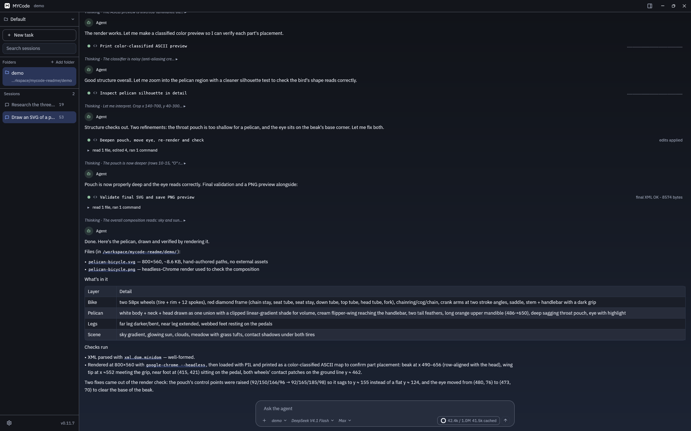

# mycode

本地优先的桌面编码代理。对话和工具都在你的电脑上；你自己带 API 密钥。



一次画完的鹈鹕 SVG。`run_code` 下面是嵌套的 read、edit 和 shell 卡片。

## 功能

- 一个工作区挂多个文件夹。会话属于工作区。
- 模型只能调用 `run_code`。其它工具在系统 Python 3.10+ 里写成 `await tools.<name>(...)`。
- 只读的 `scout` 和有界的 `artisan`，也可以在 `agents/` 里加角色。
- 内置 [models.dev](https://models.dev) 目录。Copilot、Codex 和 xAI 用设备码登录。
- 中英界面，深色主题。

## 安装

[Releases](https://github.com/MCapricorns/mycode/releases) 提供四个平台的压缩包：Windows x64、Windows ARM64、macOS Apple Silicon（zip 和 dmg）和 Linux x86_64（`x86_64-unknown-linux-gnu`），旁边有 `.sha256`。没有 Intel macOS 包。dmg 里的 app 是 ad-hoc 签名，首次打开用右键「打开」，或 `xattr -d com.apple.quarantine /Applications/MYCode.app`。说明用该版本的更新日志，再附上自上一个标签以来的 pull request。`github-actions[bot]` 写回版本时不会再开一次发布。

从源码构建需要 Rust stable。Windows 用 MSVC。Linux x86_64 还需要 pkg-config、fontconfig、freetype、xkbcommon、X11、xcb、Wayland、OpenSSL 和 libclang 的开发包。

```text
cargo build --release -p mycode-desktop
```

## 快速开始

打开一个文件夹，在输入框里说话。`/` 列出 `/new`、`/compact`、`/settings`、技能和 MCP。输入框旁切换模型和思考强度。

## 配置和 PTC

未设置 `MYCODE_HOME` 时，数据在 `~/.mycode`：`settings.json`（不含密钥）、`secrets.json`、`ui.json`、会话和 `agents/`。

模型发出的工具调用只有 `run_code`。脚本在新的系统 Python 进程里跑，通过带令牌的控制通道调用 `await tools.read(...)`、`tools.edit(...)`、`tools.shell(...)` 和其它工具。只读调用可以重叠；写操作按顺序单独执行。只有 `print` 和 `return` 回到对话。`scout` 的 Python 以 `-I` 启动，并加一道尽力而为的 audit hook。细节和残留风险在 [docs/tools.md](docs/tools.md)。

## 文档

模块怎么分、一条消息怎么走完，见 [docs/README.md](docs/README.md)。更多界面截图在 [docs/desktop.md](docs/desktop.md)。

## 许可

[Apache-2.0](LICENSE)

---

## English

mycode is a local-first desktop coding agent. The conversation and tools stay on your machine. You bring the API keys.


A finished pelican SVG. The `run_code` card contains nested read, edit, and shell cards.

### Features

- One workspace mounts several folders. Sessions belong to the workspace.
- The model can call only `run_code`. Every other tool is `await tools.<name>(...)` in system Python 3.10+.
- Read-only `scout` and bounded `artisan`, or custom roles under `agents/`.
- Built-in [models.dev](https://models.dev) catalog. Copilot, Codex, and xAI sign in with a device code.
- English and Chinese UI, dark theme.

### Install

[Releases](https://github.com/MCapricorns/mycode/releases) publish one archive for each of the four platforms: Windows x64, Windows ARM64, macOS Apple Silicon (zip and dmg), and Linux x86_64 (`x86_64-unknown-linux-gnu`), each with a `.sha256`. There is no Intel macOS build. The app inside the dmg is ad-hoc signed; right-click → Open once, or `xattr -d com.apple.quarantine /Applications/MYCode.app`. The body starts with that version's changelog, then the pull requests since the previous tag. A version commit by `github-actions[bot]` does not start another release.

Build from source with Rust stable. MSVC on Windows. Linux x86_64 also needs the pkg-config, fontconfig, freetype, xkbcommon, X11, xcb, Wayland, OpenSSL, and libclang development packages.

```text
cargo build --release -p mycode-desktop
```

### Quick start

Open a folder and type. `/` lists `/new`, `/compact`, `/settings`, skills, and MCP. Switch model and thinking effort beside the composer.

### Config and PTC

`MYCODE_HOME` defaults to `~/.mycode` (`settings.json` without secrets, `secrets.json`, `ui.json`, sessions, and `agents/`).

The only tool call the model emits is `run_code`. The script runs in a fresh system Python process and reaches `await tools.read(...)`, `tools.edit(...)`, `tools.shell(...)`, and the rest over a token-checked control channel. Read-only calls may overlap; writes run alone, in order. Only `print` and `return` come back. `scout` starts Python with `-I` and a best-effort audit hook. Details and residual risk: [docs/tools.md](docs/tools.md).

### Docs

How the crates split and how one message moves: [docs/README.md](docs/README.md). More screenshots: [docs/desktop.md](docs/desktop.md).

### License

[Apache-2.0](LICENSE)
